  <h3><code>aakash@github ~ $ whoami</code></h3>
  <table>
    <tr>
      <td valign="top"></td>
      <td valign="top"></td>
    </tr>
  </table>

   

  <h3><code>aakash@github ~ $ neofetch</code></h3>
  

    

  <h3><code>aakash@github ~ $ ls ./projects</code></h3>
  <table>
    <tr><td><a href="https://github.com/Aakashxnoir/Dungeons-and-dragons-"><code>dungeons-and-dragons</code></a></td><td>first game: a hero stuck in a dungeon, forced to defeat the boss · GDScript</td></tr>
    <tr><td><a href="https://github.com/Aakashxnoir/GoonerBoard"><code>goonerboard</code></a></td><td>discord-style hangout built with friends · TypeScript</td></tr>
    <tr><td><a href="https://github.com/Aakashxnoir/Infinitus"><code>infinitus</code></a></td><td>website for a mathematics club · JavaScript · <a href="https://infinitus-seven.vercel.app/">live</a></td></tr>
    <tr><td><a href="https://github.com/Aakashxnoir/Landroid_Analysis-App"><code>landroid-analysis-app</code></a></td><td>analysis app · TypeScript</td></tr>
    <tr><td><a href="https://github.com/Aakashxnoir/mac-styled-portfilio-"><code>mac-styled-portfolio</code></a></td><td>macOS-inspired personal portfolio · HTML · <a href="https://aakash-portfolio-smoky.vercel.app/">live</a></td></tr>
    <tr><td><a href="https://github.com/Aakashxnoir/Sevagan---Multilingual-Service-app"><code>sevagan</code></a></td><td>multilingual service app · JavaScript</td></tr>
  </table>

   

  <h3><code>aakash@github ~ $ ./contributions.sh</code></h3>
  

    

  <h3><code>aakash@github ~ $ ./links.sh</code></h3>
  

    &nbsp;
    
  

