# Aakash

Student developer. I build small, finished things — web apps, tools, the odd game — and learn by shipping them.

Mostly TypeScript, React and Python. Currently into full-stack apps with Firebase and Azure.

 

## Selected work

| Project | What it is | Stack |
| :-- | :-- | :-- |
| [**College Productivity OS**](https://github.com/Aakashxnoir/College-Productivity-OS-) | Schedule, exams, study sessions, habits and notes in one place for students | JavaScript |
| [**Life Tracker**](https://github.com/Aakashxnoir/life-tracker) | Personal habit and focus tracker with Google sign-in | React · Vite · Tailwind · Firebase |
| [**Student Library Management**](https://github.com/Aakashxnoir/Student-Library-management-) | Library operations with admin and student roles | Spring Boot · Thymeleaf · H2 |
| [**NBOS Skill Swap**](https://github.com/Aakashxnoir/NBOS-Skill-swap-) | A platform for people to trade skills with each other | JavaScript |
| [**Infinitus**](https://github.com/Aakashxnoir/Infinitus) | Website for a mathematics club | JavaScript |
| [**Dungeons & Dragons**](https://github.com/Aakashxnoir/Dungeons-and-dragons-) | First game: a hero, a dungeon, a boss | GDScript · Godot |

## Activity

## Elsewhere

[LinkedIn](https://www.linkedin.com/in/aakashbuddhakannan/) · [Portfolio repo](https://github.com/Aakashxnoir/My-new-website-)
