  <h3><code>aakash@github ~ $ whoami</code></h3>
  

    

  <h3><code>aakash@github ~ $ ./contributions.sh</code></h3>
  

    

  <h3><code>aakash@github ~ $ ./links.sh</code></h3>
  

    &nbsp;
     
    &nbsp;
    
  

   

